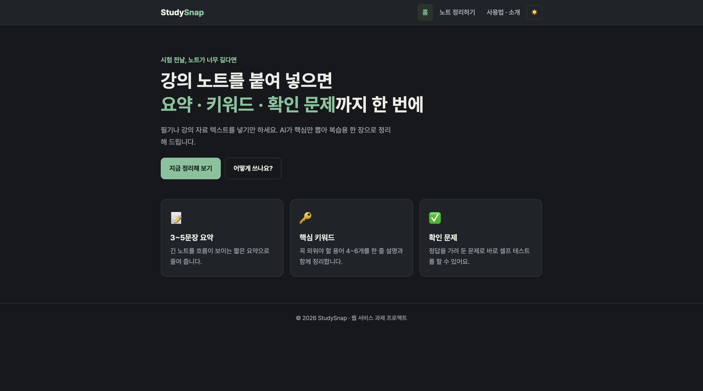
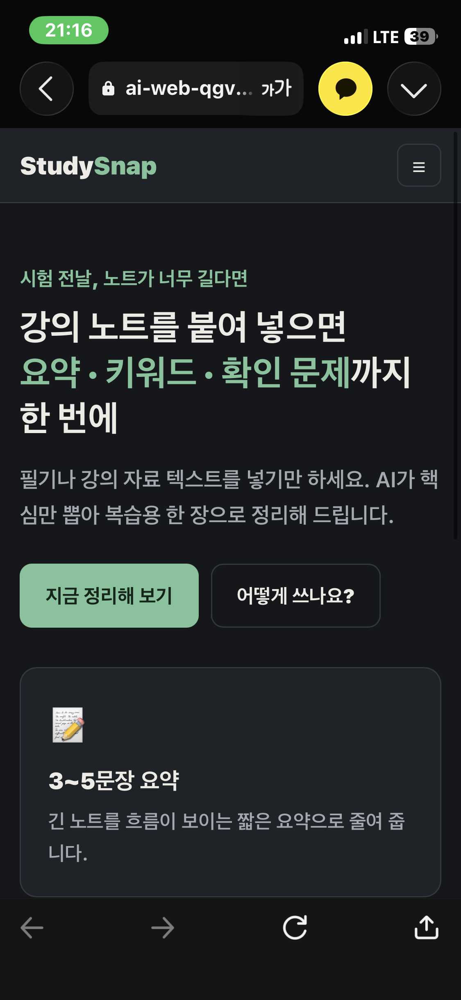
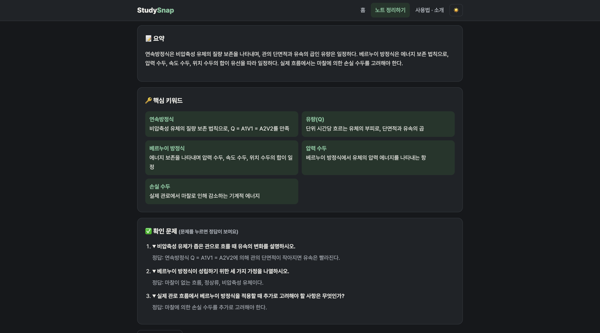

# StudySnap 📝

> 강의 노트를 붙여 넣으면 AI가 **요약 · 핵심 키워드 · 확인 문제**를 만들어 주는 복습 도우미 웹 서비스

- **배포 URL:** https://ai-web-qgvu.vercel.app
- **GitHub:** https://github.com/(본인 계정)/(저장소 이름)

<p align="center">
  
</p>

---

## 1. 서비스 소개

시험 기간, 길고 흩어진 강의 노트를 처음부터 다시 읽기 어려운 대학생을 위한 서비스입니다.
노트 텍스트를 붙여 넣으면 AI(Claude)가 내용을 분석해 **복습용 한 장**으로 정리해 줍니다.

- **목적:** 긴 노트를 짧은 시간 안에 복습할 수 있는 형태로 바꾸고, 확인 문제로 이해도를 바로 점검
- **타겟 사용자:** 여러 과목을 동시에 복습해야 하는 대학생, 수업 직후 짧은 복습 습관을 만들려는 학생

### 페이지 구성 (3페이지 + 상단 메뉴 이동)

| 페이지 | 파일 | 내용 |
|---|---|---|
| 홈 | `index.html` | 서비스 소개, 주요 기능 3가지, "지금 정리해 보기" 버튼 |
| 노트 정리하기 | `study.html` | 노트 입력 → AI 요약 / 핵심 키워드 / 확인 문제 출력 (**AI 기능**) |
| 사용법 · 소개 | `about.html` | 사용 순서, 추천 대상, 안내 사항, 기술 스택 |

- 모든 페이지 상단의 고정 메뉴로 이동하며, 현재 페이지가 강조 표시됩니다.
- 모바일(640px 이하)에서는 햄버거 메뉴(☰)로 바뀝니다.
- 우측 상단 버튼으로 **다크 모드 / 라이트 모드**를 전환할 수 있습니다. (보너스: UX 고도화)

---

## 2. 스크린샷

| 데스크톱 (홈) | 모바일 (홈) |
|---|---|
|  |  |

### AI 기능 동작 화면
강의 노트(유체역학 예시)를 입력했을 때 AI가 생성한 요약, 핵심 키워드 5개, 확인 문제 3개입니다.
확인 문제는 클릭하면 정답이 펼쳐집니다.



---

## 3. 기술 스택

| 구분 | 사용 기술 |
|---|---|
| Frontend | HTML, CSS, JavaScript (Vanilla · 프레임워크 미사용) |
| Backend | Python — Vercel Serverless Functions (`api/` 폴더) |
| AI | Claude API (코디세이 AI Gateway 경유, 모델 `claude-haiku-4`) |
| 배포 | GitHub + Vercel (push 시 자동 배포) |

---

## 4. 폴더 구조

```
studysnap/
├── index.html            # 홈
├── study.html            # AI 노트 정리
├── about.html            # 사용법 · 소개
├── css/
│   └── style.css         # 공통 스타일, 반응형(데스크톱/태블릿/모바일), 다크 모드
├── js/
│   ├── main.js           # 모바일 메뉴 토글, 다크 모드 전환
│   └── study.js          # 입력 검증, fetch('/api/study'), 결과 표시, 실패 처리
├── api/
│   └── study.py          # 서버리스 함수: AI Gateway 호출 후 결과 반환
├── images/               # 스크린샷
├── docs/
│   └── service-plan.md   # 서비스 기획서
├── requirements.txt      # Python 패키지 목록 (표준 라이브러리만 사용)
├── vercel.json           # 함수 최대 실행 시간(30초) 설정
├── .env.example          # 환경 변수 예시 (실제 키 없음)
└── .gitignore            # .env 파일 등 커밋 제외
```

프론트엔드(HTML/CSS/JS)와 백엔드(`api/`)가 분리되어 있습니다.

---

## 5. 동작 흐름

```
[사용자] 노트 입력 후 버튼 클릭
   ↓
[js/study.js] 입력값 검사 → fetch('/api/study', POST, JSON)
   ↓
[api/study.py] 환경 변수에서 키를 읽어 AI Gateway(/v1/messages) 호출
   ↓
[Claude] 요약 · 키워드 · 문제를 JSON으로 응답
   ↓
[js/study.js] 응답을 화면에 표시 (실패 시 안내 메시지)
```

- **HTML:** 화면의 구조(메뉴, 입력창, 결과 영역)
- **CSS:** 디자인과 반응형 레이아웃, 다크 모드
- **JavaScript:** 사용자 입력을 요청(fetch)으로 바꾸고, 응답을 화면에 반영
- **Python 서버리스 함수:** API 키를 숨긴 채 서버에서 AI를 호출하는 중간 역할

---

## 6. 환경 변수 설정

API 키는 **코드 · README · 스크린샷에 절대 넣지 않고** 환경 변수로만 관리합니다.
코드에서는 `os.environ.get("AI_API_KEY")`로 이름만 참조하므로 GitHub에 올려도 키가 노출되지 않습니다.

| 이름 | 필수 | 설명 |
|---|---|---|
| `AI_API_KEY` | ✅ | 코디세이 콘솔에서 발급한 API 키 |
| `AI_BASE_URL` | ✅ | AI Gateway 기본 주소 (`https://copa.codyssey.kr`) |
| `AI_MODEL` | 선택 | 모델 ID (기본값 `claude-haiku-4`) |
| `AI_API_FORMAT` | 선택 | `anthropic`(기본, `/v1/messages`) 또는 `openai`(`/v1/chat/completions`) |

- **Vercel:** 프로젝트 → Settings → Environment Variables에 추가 (Production, Preview 모두 체크) → **Redeploy**해야 적용됩니다.
- **로컬:** `.env.example`을 복사해 `.env.local`을 만들고 값을 입력합니다. (`.gitignore`에 포함되어 커밋되지 않음)
- **설정 확인:** 배포 주소의 `/api/study`에 브라우저로 접속하면 키 설정 여부, 주소, 모델이 표시됩니다. (키 값 자체는 표시되지 않음)

---

## 7. 실행 및 배포 방법

### 로컬 실행
```bash
npm i -g vercel              # 최초 1회
vercel login
vercel link                  # Vercel 프로젝트와 연결
vercel env pull .env.local   # Vercel에 저장된 환경 변수 내려받기
vercel dev                   # http://localhost:3000
```
> HTML 파일을 더블클릭해서 열면 `/api/study` 서버가 없어서 AI 기능이 동작하지 않습니다. 반드시 `vercel dev`로 실행합니다.
> **로컬 vs 배포 환경:** 로컬은 `.env.local`에서, 배포 환경은 Vercel 설정에서 환경 변수를 읽습니다. 배포에서만 오류가 나면 Vercel 환경 변수와 재배포 여부를 먼저 확인합니다.

### 배포
1. GitHub 저장소에 코드 push
2. vercel.com → Add New Project → 저장소 Import (Framework Preset: **Other**)
3. Environment Variables에 `AI_API_KEY`, `AI_BASE_URL` 입력 → Deploy
4. 이후 수정 사항은 `git push`하면 자동으로 재배포

---

## 8. AI 기능 명세

| 구분 | 내용 |
|---|---|
| 입력 | 강의 노트 텍스트 (30자 이상 ~ 6,000자 이하), 확인 문제 개수 (2 / 3 / 5개) |
| 출력 | 3~5문장 요약, 핵심 키워드 4~6개(용어 + 한 줄 설명), 확인 문제(문제 + 정답) |
| 가치 | 긴 노트를 1분 안에 훑고, 문제로 이해도를 바로 점검 |

### 실패 처리

| 상황 | 사용자에게 보여 주는 안내 |
|---|---|
| 빈 입력 / 30자 미만 / 6,000자 초과 | "강의 노트를 입력해 주세요." 등 (프론트 · 서버 양쪽에서 검사) |
| API 오류 (4xx / 5xx) | 상태 코드별 안내 + 원인(경로 · 모델 · 서버 메시지) 표시 |
| 요청 과다 (429) | "요청이 많아요. 잠시 후 다시 시도해 주세요." |
| 지연 | 8초가 지나면 "평소보다 오래 걸리고 있어요…" 안내 |
| 타임아웃 | 30초가 지나면 요청을 중단하고 "응답 시간이 초과됐어요…" 안내 |
| 중복 클릭 | 요청 중 버튼 비활성화 (불필요한 과금 방지) |

---

## 9. 보안 · 운영 메모

- 입력 길이 상한과 `max_tokens` 제한으로 AI 호출 비용 · 쿼터 낭비를 줄였습니다.
- 사용자가 입력한 노트는 서버에 저장하지 않습니다.
- 키 유출이 의심되면: 즉시 콘솔에서 **키 폐기 → 재발급 → Vercel 환경 변수 교체 → 재배포** 순서로 처리하고, 키가 커밋된 이력이 있다면 `git filter-repo` 등으로 제거합니다.

---

## 10. 제출 패키지

| 항목 | 위치 |
|---|---|
| 배포된 웹 서비스 | https://ai-web-qgvu.vercel.app |
| GitHub 저장소 | 이 저장소 |
| README | `README.md` (이 문서) |
| 서비스 기획서 | `docs/service-plan.md` |
| 스크린샷 | `images/` (데스크톱 · 모바일 · AI 동작) |
| AI 코딩 도구 사용 증빙 | Claude 대화 로그 캡처 (별도 제출) |
